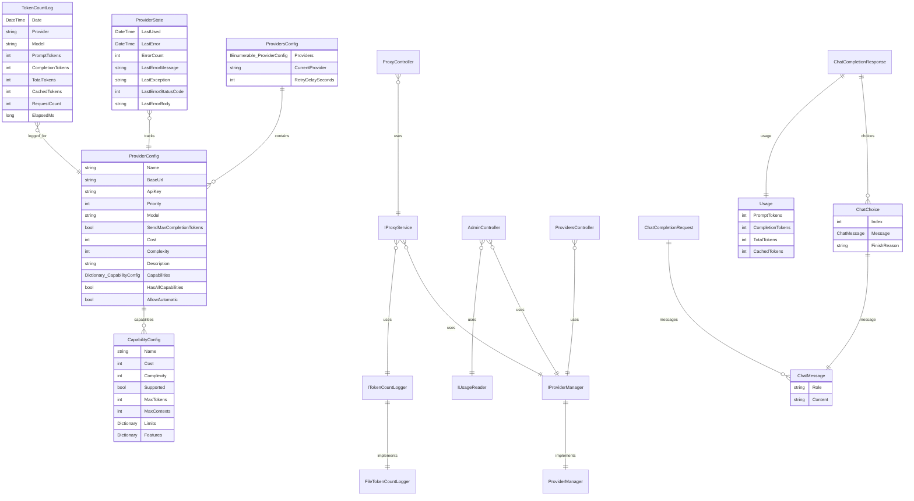

# LlmProxy Specification

## 1. Overview

**Project Name**: LlmProxy  
**Type**: ASP.NET Core Web API (C# 10, .NET 10.0)  
**Purpose**: Smart LLM proxy that automatically routes requests to the best available provider based on priority, cost, and capability requirements.

### Architecture

The system is a reverse proxy with the following components:
1. **ProxyController** - Catches all `/v1/*` routes and forwards to upstream providers
2. **ProxyService** - Implements request forwarding with automatic failover
3. **ProviderManager** - Manages provider selection, state tracking, and error handling
4. **Token Logging** - Records token usage to JSONL files
5. **Admin API** - REST endpoints for provider management and usage statistics
6. **Admin Dashboard** - Web UI for monitoring and provider control

### Configuration

Providers are loaded from `providers.json` with the following precedence:
1. `$PROVIDERS_FILE` environment variable
2. `{ContentRoot}/providers.json`
3. `~/.config/llm-proxy/providers.json`

---

## 2. Entity Relationship Diagram



---

## 3. API Surface

### 3.1 Public Endpoints

| Method | Path | Description |
|--------|------|-------------|
| GET | `/` | Redirects to `/admin` |
| GET | `/admin` | Admin dashboard HTML |
| GET | `/admin/api/providers` | Returns provider status with state |
| POST | `/admin/api/providers/active` | Set forced provider |
| DELETE | `/admin/api/providers/active` | Reset to auto-selection |
| GET | `/admin/api/usage/today` | Today's token usage statistics |
| GET | `/admin/api/usage/last30days` | Last 30 days usage |
| GET | `/api/providers` | List all providers |
| GET | `/api/providers/{key}` | Get specific provider |
| POST | `/api/providers` | Add new provider |
| PUT | `/api/providers/{key}` | Update provider |
| DELETE | `/api/providers/{key}` | Delete provider |
| GET | `/api/providers/retry-config` | Get retry delay |
| PATCH | `/api/providers/retry-config` | Update retry delay |
| GET | `/v1/models` | List available models |
| ALL | `/v1/{**catchAll}` | Proxy to upstream |

### 3.2 Service Interfaces

**IProxyService**
- `Task ProxyAsync(HttpContext context, string path, CancellationToken cancellationToken)`

**IProviderManager**
- `ProviderState? GetProviderState(ProviderConfig provider)`
- `void RecordSuccess(ProviderConfig provider)`
- `void RecordError(ProviderConfig provider, string errorMessage, Exception? exception, int? statusCode, string? responseBody)`
- `ProviderConfig? GetBestProvider()`
- `ProviderConfig? GetForcedProvider()`
- `void SetForcedProvider(string? providerKey)`
- `IEnumerable<ProviderConfig> GetAllProviders()`
- `string FullModelKey(ProviderConfig provider)`
- `ProviderConfig? GetProviderForCapability(string capability, int? maxCost, int? maxComplexity)`
- `IEnumerable<ProviderConfig> GetCapableProviders(string capability)`
- `bool ProviderSupportsCapability(ProviderConfig provider, string capability)`
- `CapabilityConfig GetCapabilityConfig(ProviderConfig provider, string capability)`

**ITokenCountLogger**
- `Task LogTokenCountAsync(TokenCountLog log, CancellationToken cancellationToken)`

**IUsageReader**
- `Task<IReadOnlyList<ProviderUsageStat>> ReadTodayAsync(CancellationToken cancellationToken)`
- `Task<IReadOnlyList<DailyUsageStat>> ReadLast30DaysAsync(CancellationToken cancellationToken)`

---

## 4. Behavioral Contracts

### 4.1 Provider Selection

**REQ-001**: The system MUST select a provider based on the following priority order:
1. Forced provider (manually set via `SetForcedProvider`)
2. Best available provider (highest priority with no recent errors)

**REQ-002**: Providers with errors within the last 1 hour MUST be excluded from automatic selection unless no other providers are available.

**REQ-003**: A provider with 2+ consecutive errors when forced MUST be automatically un-forced.

**REQ-004**: The system MUST support selecting providers by capability using `GetProviderForCapability(capability, maxCost, maxComplexity)`.

### 4.2 Request Proxying

**REQ-005**: The proxy MUST forward all HTTP methods (GET, POST, PUT, PATCH, DELETE) to upstream providers.

**REQ-006**: The proxy MUST replace the `Authorization` header with the configured provider's API key.

**REQ-007**: The proxy MUST substitute the model name in request bodies with the configured provider's model.

**REQ-008**: If `SendMaxCompletionTokens` is true, the proxy MUST rename `max_tokens` to `max_completion_tokens` in the request body.

**REQ-009**: For streaming responses (SSE), the proxy MUST include `stream_options: { include_usage: true }` to capture token usage.

**REQ-010**: The proxy MUST NOT forward hop-by-hop headers: `Connection`, `Keep-Alive`, `Transfer-Encoding`, `TE`, `Trailers`, `Upgrade`, `Proxy-Authorization`, `Proxy-Authenticate`.

### 4.3 Automatic Failover

**REQ-011**: On upstream failure (non-2xx status), the proxy MUST attempt the next available provider in priority order.

**REQ-012**: The proxy MUST wait `RetryDelaySeconds` (default: 60) before retrying on 503 or 429 responses.

**REQ-013**: The proxy MUST return 502 Bad Gateway if all providers fail.

**REQ-014**: The proxy MUST return 503 Service Unavailable if no providers are configured.

### 4.4 Usage Tracking

**REQ-015**: The system MUST log token usage to `{AppBaseDirectory}/logs/tokens-{yyyy-MM-dd}.jsonl`.

**REQ-016**: Each log entry MUST include: Date, Provider, Model, PromptTokens, CompletionTokens, TotalTokens, CachedTokens, RequestCount, ElapsedMs.

**REQ-017**: Usage MUST be parsed from the `usage` field in the response JSON.

### 4.5 Model Selection

**REQ-018**: Model `llm-proxy:auto` MUST use automatic provider selection.

**REQ-019**: Model in format `providerName:model` MUST route to that specific provider.

---

## 5. Domain Types

### 5.1 Core Records

```csharp
record ProviderConfig(
    string Name,
    string BaseUrl,
    string ApiKey,
    int Priority,
    string Model,
    bool SendMaxCompletionTokens = false,
    int Cost = 0,
    int Complexity = 0,
    string? Description = null,
    Dictionary<string, CapabilityConfig>? Capabilities = null,
    bool HasAllCapabilities = true,
    bool AllowAutomatic = true);

record CapabilityConfig(
    string Name,
    int Cost,
    int Complexity,
    bool Supported,
    int? MaxTokens = null,
    int? MaxContexts = null,
    Dictionary<string, object>? Limits = null,
    Dictionary<string, object>? Features = null);

record ProviderState(
    DateTime LastUsed,
    DateTime? LastError,
    int ErrorCount,
    string? LastErrorMessage,
    string? LastException,
    int? LastErrorStatusCode,
    string? LastErrorBody);

record TokenCountLog(
    DateTime Date,
    string Provider,
    string Model,
    int PromptTokens,
    int CompletionTokens,
    int TotalTokens,
    int CachedTokens,
    int RequestCount,
    long ElapsedMs);
```

### 5.2 Chat Types

```csharp
record ChatMessage(string Role, string Content);
record ChatCompletionRequest(string Model, IEnumerable<ChatMessage> Messages, bool Stream = false);
record ChatChoice(int Index, ChatMessage Message, string FinishReason);
record ChatCompletionResponse(string Id, string Object, long Created, string Model, IEnumerable<ChatChoice> Choices, Usage Usage);
record Usage(int PromptTokens, int CompletionTokens, int TotalTokens, int CachedTokens = 0);
```

---

## 6. Cross-Cutting Concerns

### 6.1 Thread Safety

- `ProviderManager` uses `ConcurrentDictionary` for thread-safe state management.
- `_forcedProvider` is marked `volatile` for thread-safe read/write.

### 6.2 Error Handling

- All provider errors are recorded with timestamp, message, exception, status code, and truncated response body.
- Response bodies are truncated to 500 characters to prevent excessive memory use.
- Errors older than 1 hour are cleared from provider state.

### 6.3 Logging

- Uses Serilog with file, console, and debug sinks.
- Request logging enabled via `UseSerilogRequestLogging()`.
- Semantic logging for proxy operations (forwarding, errors, usage).

### 6.4 Resource Lifecycle

- `IProxyService` - Scoped lifetime
- `IProviderManager` - Singleton lifetime (maintains state)
- `ITokenCountLogger` - Scoped lifetime
- `IUsageReader` - Scoped lifetime

---

## 7. Configuration Validation

**REQ-020**: Provider name MUST NOT be empty.

**REQ-021**: Provider BaseUrl MUST NOT be empty.

**REQ-022**: Provider Model MUST NOT be empty.

**REQ-023**: Provider Cost and Complexity MUST be between 0 and 10.

**REQ-024**: Capability Cost and Complexity MUST be between 0 and 10.

**REQ-025**: Capability name MUST NOT be `*` (use provider-level `HasAllCapabilities` instead).

---

## 8. Source Evidence

| Requirement | Source |
|-------------|--------|
| Provider selection logic | `ProviderManager.cs:86-101` |
| Error exclusion (1 hour) | `ProviderManager.cs:88-90` |
| Auto-unforce after 2 errors | `ProviderManager.cs:60-63` |
| Authorization replacement | `ProxyService.cs:89` |
| Model substitution | `ProxyService.cs:169-173` |
| max_tokens renaming | `ProxyService.cs:174-177` |
| Stream options injection | `ProxyService.cs:192-196` |
| Hop-by-hop headers | `ProxyService.cs:18-25` |
| Failover logic | `ProxyService.cs:46-82` |
| 503/429 retry delay | `ProxyService.cs:67-68` |
| Usage parsing | `ProxyService.cs:138-163` |
| Token logging | `FileTokenCountLogger.cs:23-41` |
| Provider key format | `ProviderManager.cs:107` (`{BaseUrl}\|{Model}`) |
| Full model key format | `ProviderManager.cs:38` (`{Name}:{Model}`) |
| Capability wildcard | `ProviderManager.cs:77-79` |
| Capability check | `ProviderManager.cs:82-86` |

---

## 9. File Structure

```
src/LlmProxy/
├── Program.cs                          # Entry point, DI configuration
├── LlmProxy.csproj                   # Project file
├── appsettings.json                    # App configuration
├── providers.json                      # Provider configuration (template)
├── wwwroot/
│   └── admin.html                      # Admin dashboard
├── Api/
│   ├── Controllers/
│   │   ├── AdminController.cs          # Admin endpoints
│   │   ├── ProvidersController.cs      # Provider CRUD
│   │   ├── ProxyController.cs          # Catch-all proxy
│   │   └── ModelsController.cs         # Model listing
│   ├── Requests/
│   │   └── SetActiveProviderRequest.cs
│   └── Responses/
│       ├── ProviderInfoDto.cs
│       ├── ProvidersStatusDto.cs
│       ├── ProviderUsageStatDto.cs
│       └── ...
├── Application/
│   ├── Configuration/
│   │   └── ProvidersConfig.cs          # Config model + validation
│   └── Services/
│       ├── IProxyService.cs
│       ├── ProxyService.cs              # Core proxy logic
│       ├── IProviderManager.cs
│       ├── ProviderManager.cs           # Provider selection
│       ├── ITokenCountLogger.cs
│       ├── FileTokenCountLogger.cs      # JSONL logging
│       ├── IUsageReader.cs
│       ├── FileUsageReader.cs           # Usage reading
│       └── ProviderUsageStat.cs
└── Domain/
    ├── ProviderConfig.cs
    ├── ProviderState.cs
    ├── CapabilityConfig.cs
    ├── ChatMessage.cs
    ├── ChatCompletionRequest.cs
    ├── ChatCompletionResponse.cs
    ├── ChatChoice.cs
    ├── Usage.cs
    └── TokenCountLog.cs

src/LlmProxy.Tests/
├── (unit tests for each component)
```
