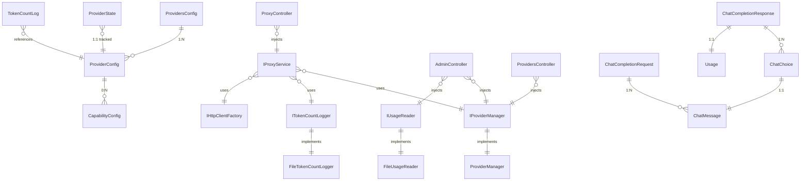
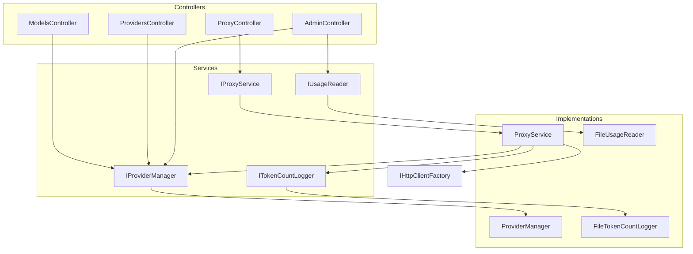
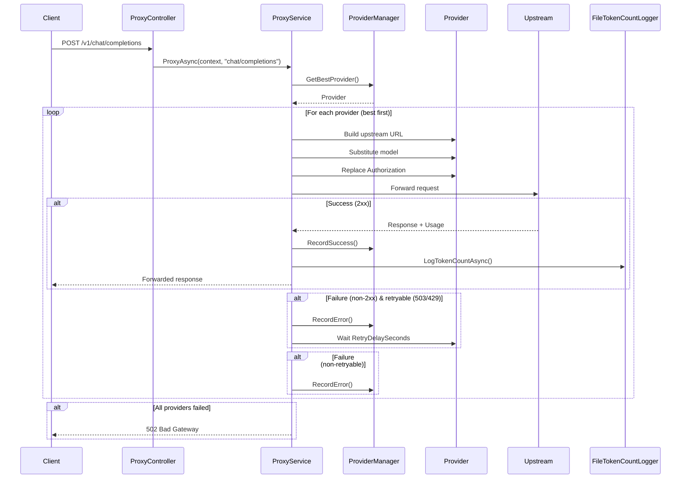
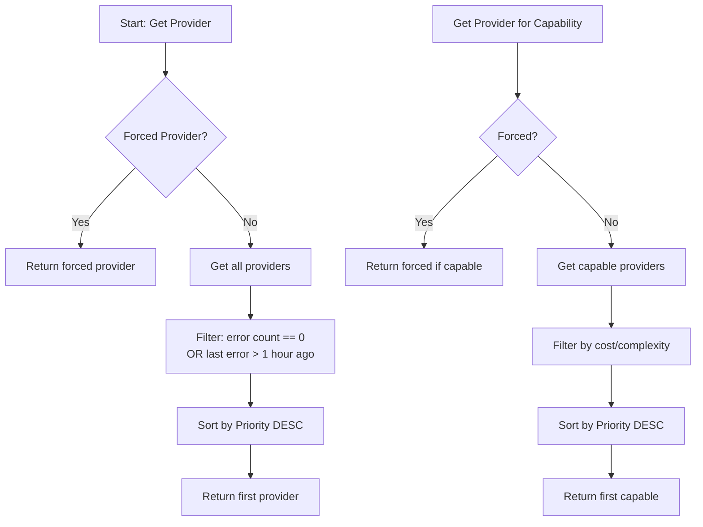

# Entity Relationship Diagram

## Core Entities



## Domain Types

```mermaid
erDiagram
    ProvidersConfig {
        IEnumerable_ProviderConfig_ProviderList Providers
        string CurrentProvider
        int RetryDelaySeconds 60
    }

    ProviderConfig {
        string Name
        string BaseUrl
        string ApiKey
        int Priority
        string Model
        bool SendMaxCompletionTokens
        int Cost
        int Complexity
        string Description
        Dictionary_CapabilityConfig_Capabilities
        bool HasAllCapabilities
        bool AllowAutomatic
        bool AutoDiscovered
    }

    CapabilityConfig {
        string Name
        int Cost
        int Complexity
        bool Supported
        int_MaxTokens
        int_MaxContexts
        Dictionary_string_object_Limits
        Dictionary_string_object_Features
    }

    ProviderState {
        DateTime LastUsed
        datetime LastError
        int ErrorCount
        string LastErrorMessage
        string LastException
        int LastErrorStatusCode
        string LastErrorBody
    }

    TokenCountLog {
        date Date
        string Provider
        string Model
        int PromptTokens
        int CompletionTokens
        int TotalTokens
        int CachedTokens
        int RequestCount
        long ElapsedMs
    }

    ChatMessage {
        string Role
        string Content
    }

    ChatChoice {
        int Index
        ChatMessage Message
        string FinishReason
    }

    ChatCompletionRequest {
        string Model
        List_ChatMessage Messages
        bool Stream
    }

    ChatCompletionResponse {
        string Id
        string Object
        long Created
        string Model
        List_ChatChoice Choices
        Usage Usage
    }

    Usage {
        int PromptTokens
        int CompletionTokens
        int TotalTokens
        int CachedTokens
    }

    ProviderUsageStat {
        string Provider
        string Model
        int RequestCount
        int PromptTokens
        int CompletionTokens
        int TotalTokens
        int CachedTokens
        long TotalElapsedMs
    }

    DailyUsageStat {
        dateonly Date
        int RequestCount
        int PromptTokens
        int CompletionTokens
        int TotalTokens
    }
```

## Service Dependencies



## Request Flow



## Provider Selection Logic



## Configuration Loading

```mermaid
flowchart TD
    A[Start] --> B{PROVIDERS_FILE env var?}
    B -->|Set| C[Use env var path]
    B -->|Not set| D{ContentRoot/providers.json exists?}
    D -->|Yes| C
    D -->|No| E(~/.config/llm-proxy/providers.json exists?)
    E -->|Yes| F[Use user config path]
    E -->|No| G[Use default empty config]
    
    C --> H[Load JSON]
    F --> H
    G --> H
    H --> I[Parse ProvidersConfig]
    I --> J[Validate()]
    J --> K[Ready]
```